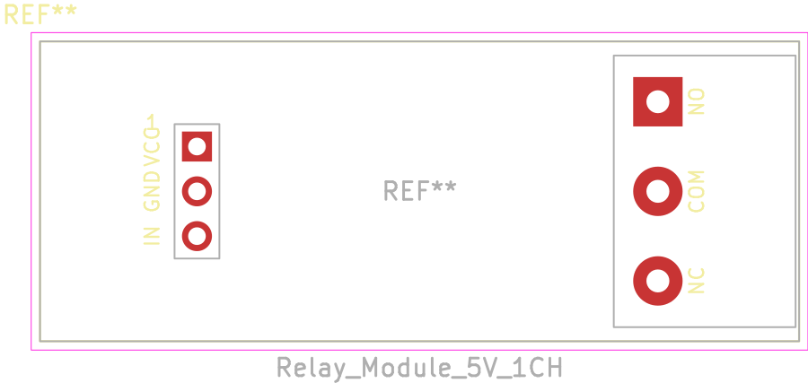

# KiCad 5V Relay Module Library

KiCad V6+ symbol and footprint for the common **1-channel 5V relay breakout module** built around the **JQC-3FF-S-Z** relay (10 A / 250 VAC), sold as “1 channel 5V relay module” on Trendyol, AliExpress, Amazon and similar marketplaces.

This library models the complete module — input header, relay driver and screw terminal — not the bare relay. If you need the bare JQC-3FF-S-Z component, use the manufacturer datasheet with KiCad’s `Relay_SPDT` symbol and a matching 5-pin relay footprint.



---

## What’s included

```
Relay_Module_5V_1CH.kicad_sym          — Symbol (VCC, GND, IN, NO, COM, NC)
Relay_Module_5V_1CH.pretty/
└── Relay_Module_5V_1CH.kicad_mod      — Module footprint
```

---

## The module this targets

| Property | Value |
|---|---|
| Channels | 1 |
| Coil voltage | 5 V DC |
| Relay | JQC-3FF-S-Z, SPDT |
| Contact rating | 10 A 250 VAC / 15 A 125 VAC |
| Control header | 1×3, 2.54 mm — VCC, GND, IN |
| Load terminal | 1×3, 5.08 mm — NO, COM, NC |
| Board size | 43 × 17 mm |
| Mounting holes | None |
| Trigger | Active-low on most boards of this layout; check your listing for a high-level variant |

---

## Pinout

| Symbol pin | Board label | Type | Notes |
|---:|---|---|---|
| 1 | VCC / DC+ | Power in | 5 V coil supply |
| 2 | GND / DC− | Power in | Ground |
| 3 | IN | Input | Trigger input |
| 4 | NO | Passive | Normally open contact |
| 5 | COM | Passive | Common contact |
| 6 | NC | Passive | Normally closed contact |

Pin 1 is the square pad. On the module, the input header is on the left and the screw terminal is on the right.

---

## Installation

### 1. Clone or download

```bash
git clone https://github.com/V01Ddev/kicad-relay-module-5v-library.git
```

Or download the ZIP from the green **Code** button above.

### 2. Add the symbol library

In KiCad: **Preferences > Manage Symbol Libraries > Add existing library**

Point it to:

```
/path/to/kicad-relay-module-5v-library/Relay_Module_5V_1CH.kicad_sym
```

### 3. Add the footprint library

In KiCad: **Preferences > Manage Footprint Libraries > Add existing library**

Point it to the `.pretty` folder:

```
/path/to/kicad-relay-module-5v-library/Relay_Module_5V_1CH.pretty
```

The assigned footprint is `Relay_Module_5V_1CH:Relay_Module_5V_1CH`.

---

## Footprint details

- Board outline 43 × 17 mm on `F.SilkS`, `F.Fab` and `F.CrtYd`
- 3 input pads at 2.54 mm pitch, 1.7 mm pad / 1.0 mm drill
- 3 terminal pads at 5.08 mm pitch, 2.8 mm pad / 1.3 mm drill
- Pin 1 and pin 4 use square pads for orientation
- Silkscreen labels: VCC, GND, IN, NO, COM, NC
- No mounting holes (the module has none)

Connector positions, measured from the board’s top-left corner:

| Feature | Position |
|---|---|
| Input pads | X = 8.89 mm; Y = 5.96 / 8.50 / 11.04 mm |
| Terminal pads | X = 35.0 mm; Y = 3.42 / 8.50 / 13.58 mm |

The footprint represents the module’s own pin positions. If you mount the module on a carrier board, use matching female headers or solder the module pins directly.

---

## Verification

The 43 × 17 mm board outline is from the product listing. The connector X positions were measured from the product photos and are the only estimated values. Measure your board with calipers before ordering a PCB, especially if the module will be mounted through headers.

---

## Tested with

- KiCad 10 on Arch Linux
- Generic 1-channel 5V JQC-3FF-S-Z relay module (43 × 17 mm)

---

## Source module

[Trendyol — 1 Kanal 5V Röle Modül 220V 10A](https://www.trendyol.com/genel-markalar/1-kanal-5v-role-modul-220v-10a-guc-kontrol-anahtari-p-1020832249?boutiqueId=61&merchantId=979702)

---

## License

[CC BY-NC-SA 4.0](https://creativecommons.org/licenses/by-nc-sa/4.0/) — Attribution-NonCommercial-ShareAlike 4.0 International.

This library is an original work by [v01d.dev](https://github.com/V01Ddev), distributed under the same license as the other KiCad libraries in this account.
